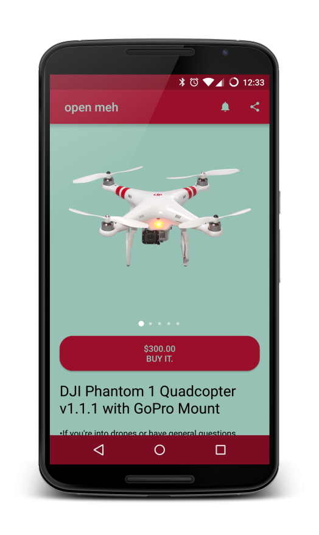

# open meh

meh.com Compose Multiplatform app



<a href="https://play.google.com/store/apps/details?id=com.jawnnypoo.openmeh">
  
</a>

[meh.com](https://meh.com/) is a deal of the day shopping experience filled with humorous writing and great personality. Once they opened up support for an API, an Android app was born.

## Building
Generate your own API key from [meh](https://meh.com/forum/topics/meh-api) and add it to a `local.properties` file at the project root (already gitignored):
```properties
MEH_API_KEY=your_api_key_here
```

For a signed release build, also add the keystore properties to the root `gradle.properties` (or pass them as `-P` flags / `ORG_GRADLE_PROJECT_*` env vars on CI):
```properties
KEYSTORE_NAME=your_keystore.jks
KEYSTORE_PASSWORD=...
KEY_PASSWORD=...
```
The keystore file itself lives in `androidApp/`. Then build with:
```
./gradlew androidApp:bundleRelease
```

## Contribution
Pull requests are welcomed and encouraged. If you experience any bugs, please [file an issue](https://github.com/Jawnnypoo/open-meh/issues/new)

License
=======

    Copyright 2026 John Carlson

    Licensed under the Apache License, Version 2.0 (the "License");
    you may not use this file except in compliance with the License.
    You may obtain a copy of the License at

       http://www.apache.org/licenses/LICENSE-2.0

    Unless required by applicable law or agreed to in writing, software
    distributed under the License is distributed on an "AS IS" BASIS,
    WITHOUT WARRANTIES OR CONDITIONS OF ANY KIND, either express or implied.
    See the License for the specific language governing permissions and
    limitations under the License.
